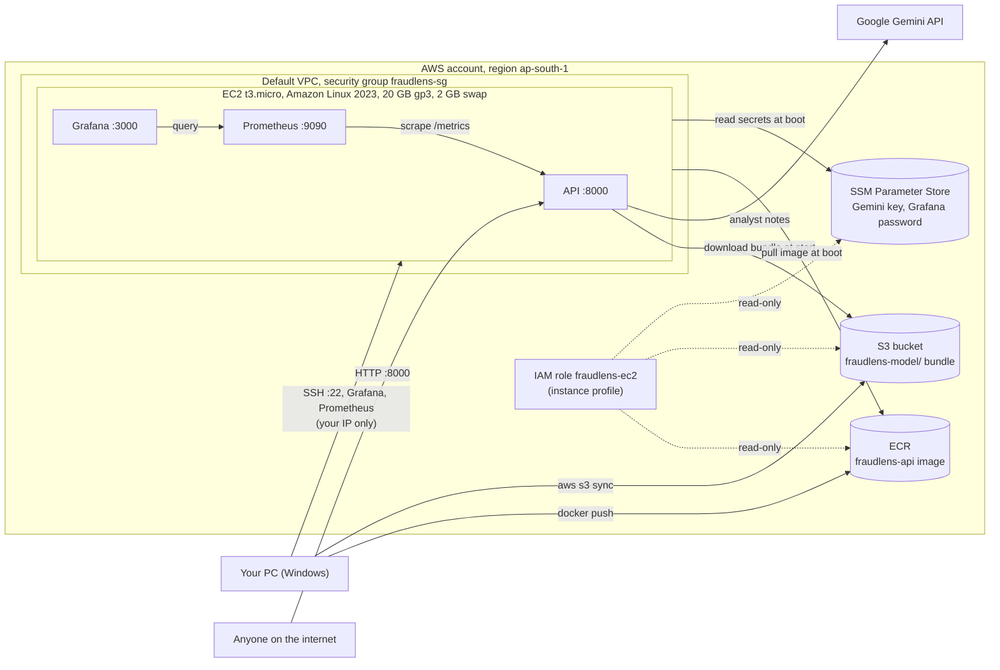

# AWS deployment blueprint (deploy once, verify, tear down)

FraudLens runs on a single EC2 instance in **ap-south-1 (Mumbai)**: the scoring API, Prometheus and
Grafana in Docker, with the API image in **ECR**, the model bundle in **S3**, secrets in **SSM
Parameter Store**, and an **IAM instance role** instead of keys on the server. The public demo
stays on Render (Phase 11); this is the production blueprint, run once to prove it works and then
removed.

Every command below is **PowerShell**, run from the project folder on Windows. Nothing here runs
automatically: you run each block yourself, in order.

## Architecture



| Piece | What it is | Why |
|---|---|---|
| ECR `fraudlens-api` | Private image repository, scan on push | The exact image CI builds; the server pulls it, never builds |
| S3 `fraudlens-<account>-ap-south-1` | Private bucket, public access blocked | Model, metadata, card state and demo set (`fraudlens stage-model`, 13 files, ~1.8 MB) |
| SSM parameters `/fraudlens/*` | SecureString (free standard tier) | Gemini key and Grafana password, read at boot by the instance role |
| IAM role `fraudlens-ec2` | Read-only: one bucket prefix, one ECR repo, `/fraudlens/*` parameters | No access keys on the server ([policy](../aws/ec2-permissions-policy.json)) |
| EC2 `t3.micro` | Amazon Linux 2023, 20 GB encrypted gp3, 2 GB swap, IMDSv2 only | Smallest Free-plan type; set up by [`aws/user-data.sh`](../aws/user-data.sh) |
| Security group `fraudlens-sg` | 8000 open; 22, 3000, 9090 from your IP only | The API is the only public surface |
| [`docker-compose.aws.yml`](../docker-compose.aws.yml) | API (640 MB) + Prometheus (160 MB) + Grafana (192 MB) | Memory limits sum to < 1 GiB; swap absorbs the startup peak |

## 0. One-time setup on your PC

1. **Install the AWS CLI v2** (needs version 2.32 or later for `aws login`):

   ```powershell
   msiexec.exe /i https://awscli.amazonaws.com/AWSCLIV2.msi
   # close and reopen PowerShell, then:
   aws --version
   ```

2. **Protect the root user and create an IAM user** (AWS console, signed in as root, once):
   - Turn on MFA for the root user (top-right menu > Security credentials). Never use root again.
   - IAM > Users > Create user `fraudlens-admin`, with **console access**. Attach the managed
     policies `AdministratorAccess` (this one-off deployment touches EC2, ECR, S3, IAM, SSM and
     Budgets; the user is deleted at teardown) and `SignInLocalDevelopmentAccess` (for `aws login`).
   - Sign out, sign in as `fraudlens-admin`, and turn on MFA for it too.

3. **Sign the CLI in with that user** (short-lived credentials, no access keys to leak):

   ```powershell
   aws login --profile fraudlens          # opens the browser; pick the fraudlens-admin session
   aws configure set region ap-south-1 --profile fraudlens
   $env:AWS_PROFILE = "fraudlens"
   aws sts get-caller-identity             # Arn must end in user/fraudlens-admin, NOT root
   ```

   `aws login` credentials last up to 12 hours; run it again if a command says they expired.

## 1. Pre-flight: plan, budget, variables

1. **Check the plan.** Console > Billing and Cost Management > Free plan (or Credits): note the
   credits left and the end date. On the Free plan (accounts opened after 15 July 2025) EC2 has no
   separate free hours; usage draws down the credits.
2. **Session variables** (run this block at the start of every new PowerShell session; it
   re-creates everything later steps use, from AWS itself):

   ```powershell
   $env:AWS_PROFILE = "fraudlens"
   $Region   = "ap-south-1"
   $Account  = aws sts get-caller-identity --query Account --output text
   $Bucket   = "fraudlens-$Account-$Region"
   $Registry = "$Account.dkr.ecr.$Region.amazonaws.com"
   $MyIp     = (Invoke-RestMethod https://checkip.amazonaws.com).Trim()
   New-Item -ItemType Directory -Force dist | Out-Null
   "$Account $Bucket $MyIp"
   ```

3. **Budget with email alerts** ($5 a month; alerts when actual spend passes $1 and when the
   forecast passes $5). The first two budgets in an account are free.

   ```powershell
   (Get-Content aws\budget-notifications.json -Raw).Replace('you@example.com', 'yashrudrawar@gmail.com') |
       Set-Content dist\budget-notifications.json -Encoding ascii
   aws budgets create-budget --account-id $Account --budget file://aws/budget.json `
       --notifications-with-subscribers file://dist/budget-notifications.json
   ```

   Confirm the subscription email AWS sends.

### Expected cost (approximate, ap-south-1 on-demand prices)

| Resource | Rate | For a 6-hour run |
|---|---|---|
| EC2 t3.micro (standard credits) | ~$0.011/hour | ~$0.07 |
| Public IPv4 address | $0.005/hour | $0.03 |
| EBS gp3, 20 GB | ~$0.09/GB-month | ~$0.02 |
| ECR storage, ~0.7 GB image | $0.10/GB-month | < $0.01 |
| S3 (1.8 MB), SSM standard parameters, IAM, Budgets | free or < $0.01 | ~$0 |
| **Total** | | **well under $1** |

All of it comes out of the Free-plan credits. Costs only grow if something is **left running**,
which the teardown checklist prevents.

## 2. ECR: push the API image

```powershell
aws ecr create-repository --repository-name fraudlens-api `
    --image-scanning-configuration scanOnPush=true --region $Region

docker build -f docker/api.Dockerfile -t "$Registry/fraudlens-api:latest" .
aws ecr get-login-password --region $Region |
    docker login --username AWS --password-stdin $Registry
docker push "$Registry/fraudlens-api:latest"

aws ecr describe-images --repository-name fraudlens-api `
    --query "imageDetails[0].[imageTags[0],imageSizeInBytes]" --output text
```

The image is built for `linux/amd64`, which matches t3 instances (do not pick a `t4g` type: those
are ARM).

## 3. S3: upload the model bundle

```powershell
aws s3api create-bucket --bucket $Bucket --region $Region `
    --create-bucket-configuration LocationConstraint=$Region
aws s3api get-public-access-block --bucket $Bucket   # all four settings must be true

uv run fraudlens stage-model                        # -> dist\model-bundle (13 files)
aws s3 sync dist/model-bundle "s3://$Bucket/fraudlens-model/"
aws s3 ls "s3://$Bucket/fraudlens-model/" --recursive --human-readable
```

## 4. SSM Parameter Store: secrets

Values are passed through variables, so they never appear in PowerShell's history.

```powershell
$GeminiKey = (Select-String -Path .env -Pattern '^GOOGLE_API_KEY=(.+)$').Matches[0].Groups[1].Value
$GrafanaPassword = -join ((48..57) + (65..90) + (97..122) | Get-Random -Count 20 | ForEach-Object { [char]$_ })
aws ssm put-parameter --name /fraudlens/google-api-key --type SecureString --value $GeminiKey
aws ssm put-parameter --name /fraudlens/grafana-admin-password --type SecureString --value $GrafanaPassword
Remove-Variable GeminiKey
```

Skip the Gemini parameter to run without the LLM: analyst notes then use the template fallback.

## 5. IAM: role and instance profile for EC2

```powershell
aws iam create-role --role-name fraudlens-ec2 `
    --assume-role-policy-document file://aws/ec2-trust-policy.json
(Get-Content aws\ec2-permissions-policy.json -Raw).Replace('ACCOUNT_ID', $Account).Replace('REGION', $Region) |
    Set-Content dist\ec2-permissions-policy.json -Encoding ascii
aws iam put-role-policy --role-name fraudlens-ec2 --policy-name fraudlens-ec2-read-only `
    --policy-document file://dist/ec2-permissions-policy.json
aws iam create-instance-profile --instance-profile-name fraudlens-ec2
aws iam add-role-to-instance-profile --instance-profile-name fraudlens-ec2 --role-name fraudlens-ec2
```

## 6. Network: key pair and security group

```powershell
# SSH key generated on your PC; only the public half goes to AWS. Press Enter for no passphrase
# (or set one).
ssh-keygen -t ed25519 -f "$HOME\.ssh\fraudlens" -C fraudlens
aws ec2 import-key-pair --key-name fraudlens --public-key-material "fileb://$HOME/.ssh/fraudlens.pub"

$Vpc = aws ec2 describe-vpcs --filters Name=is-default,Values=true --query "Vpcs[0].VpcId" --output text
$Sg = aws ec2 create-security-group --group-name fraudlens-sg --description "FraudLens demo" `
    --vpc-id $Vpc --query GroupId --output text
aws ec2 authorize-security-group-ingress --group-id $Sg --protocol tcp --port 8000 --cidr 0.0.0.0/0
foreach ($Port in 22, 3000, 9090) {
    aws ec2 authorize-security-group-ingress --group-id $Sg --protocol tcp --port $Port --cidr "$MyIp/32"
}
```

If your home IP changes (many Indian ISPs rotate it), re-run the `foreach` with the new `$MyIp`.

## 7. Launch the instance

```powershell
$Id = aws ec2 run-instances --region $Region `
    --image-id resolve:ssm:/aws/service/ami-amazon-linux-latest/al2023-ami-kernel-default-x86_64 `
    --instance-type t3.micro --key-name fraudlens --security-group-ids $Sg `
    --iam-instance-profile Name=fraudlens-ec2 `
    --block-device-mappings file://aws/block-devices.json `
    --user-data file://aws/user-data.sh `
    --credit-specification CpuCredits=standard `
    --metadata-options "HttpTokens=required,HttpEndpoint=enabled,HttpPutResponseHopLimit=2" `
    --tag-specifications "ResourceType=instance,Tags=[{Key=Name,Value=fraudlens}]" "ResourceType=volume,Tags=[{Key=Name,Value=fraudlens}]" `
    --query "Instances[0].InstanceId" --output text
$Id
aws ec2 wait instance-running --instance-ids $Id
$Ip = aws ec2 describe-instances --instance-ids $Id `
    --query "Reservations[0].Instances[0].PublicIpAddress" --output text
$Ip
```

- `CpuCredits=standard`: t3 instances default to *unlimited* mode, which bills extra when the CPU
  stays busy. Standard mode throttles instead of billing.
- `HttpPutResponseHopLimit=2`: containers sit one network hop behind the host, so with the default
  of 1 the API could not fetch the instance role's credentials from IMDSv2 to read S3.
- An error saying the instance profile is invalid right after step 5 means IAM has not propagated
  yet: wait 15 seconds and run the command again.

## 8. Verify

The first boot takes about 5-8 minutes (packages, a ~1.8 GB image pull, then the model load).

```powershell
# Follow the setup log until "FraudLens setup finished":
ssh -i "$HOME\.ssh\fraudlens" "ec2-user@$Ip" "sudo tail -n 25 /var/log/fraudlens-setup.log"
ssh -i "$HOME\.ssh\fraudlens" "ec2-user@$Ip" "docker ps; free -m"

curl.exe "http://${Ip}:8000/ready"
curl.exe "http://${Ip}:8000/model-info"            # "source": "s3"

# Some traffic for Grafana, then open the dashboards:
uv run fraudlens replay --url "http://${Ip}:8000" --limit 600 --speed 5
Start-Process "http://${Ip}:8000/docs"
Start-Process "http://${Ip}:3000"                    # user admin, password below
aws ssm get-parameter --name /fraudlens/grafana-admin-password --with-decryption `
    --query Parameter.Value --output text
```

### Checklist and screenshots (save to `docs/screenshots/aws/`)

- [ ] `ec2-console.png`: EC2 > Instances, `fraudlens` running, t3.micro, ap-south-1.
- [ ] `ecr-image.png`: ECR > `fraudlens-api`, the `latest` image with its scan result.
- [ ] `s3-bucket.png`: S3 > the bucket's `fraudlens-model/` folder.
- [ ] `api-docs.png`: `http://<ip>:8000/docs` with a successful `/predict_explained` response.
- [ ] `model-info.png`: `/model-info` showing `"source": "s3"`.
- [ ] `grafana.png`: the FraudLens dashboard during the replay.
- [ ] `free-m.png` (optional): `docker ps; free -m` over SSH, showing memory and swap use.

## 9. Things that cause unexpected charges (avoided here)

| Avoid | Why it costs money | What this setup does instead |
|---|---|---|
| NAT gateways | ~$0.06/hour each, plus data processing, even when idle | Default VPC, public subnet: no NAT |
| Elastic IPs | Billed whenever allocated, attached or not | Uses the instance's auto-assigned public IP; none allocated |
| Larger instance types | t3.small doubles the rate, m/c types much more | t3.micro |
| t3 unlimited mode | Surplus CPU credits billed | `CpuCredits=standard` |
| Load balancers | Hourly charge plus a public IP per zone | Port 8000 directly |
| Leftover EBS volumes and snapshots | Billed per GB-month after the instance is gone | `DeleteOnTermination: true`; no snapshots taken |
| Leaving anything running | Every hour counts | Teardown below, then a Billing check |

## 10. Teardown checklist

Run the session-variables block from step 1 first if this is a new PowerShell window.

```powershell
# EC2 and its disk (the volume is deleted with the instance)
$Id = aws ec2 describe-instances --filters Name=tag:Name,Values=fraudlens `
    "Name=instance-state-name,Values=pending,running,stopping,stopped" `
    --query "Reservations[].Instances[].InstanceId" --output text
aws ec2 terminate-instances --instance-ids $Id
aws ec2 wait instance-terminated --instance-ids $Id

# Network
$Sg = aws ec2 describe-security-groups --filters Name=group-name,Values=fraudlens-sg `
    --query "SecurityGroups[0].GroupId" --output text
aws ec2 delete-security-group --group-id $Sg
aws ec2 delete-key-pair --key-name fraudlens

# Image, bundle, secrets
aws ecr delete-repository --repository-name fraudlens-api --force
aws s3 rm "s3://$Bucket" --recursive
aws s3api delete-bucket --bucket $Bucket
aws ssm delete-parameters --names /fraudlens/google-api-key /fraudlens/grafana-admin-password

# IAM role and instance profile
aws iam remove-role-from-instance-profile --instance-profile-name fraudlens-ec2 --role-name fraudlens-ec2
aws iam delete-instance-profile --instance-profile-name fraudlens-ec2
aws iam delete-role-policy --role-name fraudlens-ec2 --policy-name fraudlens-ec2-read-only
aws iam delete-role --role-name fraudlens-ec2
```

**Confirm nothing is left** (each command should print nothing or an empty list):

```powershell
aws ec2 describe-instances --filters Name=tag:Name,Values=fraudlens "Name=instance-state-name,Values=pending,running,stopping,stopped" --query "Reservations[].Instances[].InstanceId" --output text
aws ec2 describe-volumes --query "Volumes[].VolumeId" --output text
aws ec2 describe-snapshots --owner-ids self --query "Snapshots[].SnapshotId" --output text
aws ec2 describe-addresses --query "Addresses[].PublicIp" --output text
aws ecr describe-repositories --query "repositories[].repositoryName" --output text
aws s3 ls
aws ssm describe-parameters --query "Parameters[].Name" --output text
aws iam list-roles --query "Roles[?starts_with(RoleName, 'fraudlens')].RoleName" --output text
```

Then, in the console:

- [ ] Billing and Cost Management > Bills: no charges beyond the run, and credits used as expected.
- [ ] EC2 > Global view (all regions): 0 instances, 0 volumes, 0 Elastic IPs.
- [ ] Keep the budget (free) as a safety net, or delete it: `aws budgets delete-budget --account-id $Account --budget-name fraudlens-monthly`.
- [ ] Finally, delete the IAM user `fraudlens-admin` (console, signed in as root). Its CLI
      session stops working with it.
